# Setting up the app from scratch

A new RunPod account and a new copy of the app, to a running pod. About 20 minutes, most of it the
first image pull. The screenshots are taken by the app's own test
(`apps/runpod-dashboard/e2e-electron/walkthrough.spec.js`, run with `WALKTHROUGH=1 ./start.sh e2e-app walkthrough.spec.js`),
so they show the real screens; the steps from "No-spend mode" on use the app's simulated account, so nothing is
created or billed in the screenshots. Every step is checked by that test, so this page cannot drift from the app.

**The order:** (1) credentials on RunPod, (2) Default Configuration in the app, (3) a network volume, (4) a pod.

## 1. What you need from RunPod and GitHub first

| What | Where | Used for | Required |
|---|---|---|---|
| **RunPod API key** (`rpa_…`) | RunPod → Settings → API Keys → Create (read/write) | Everything: create, stop, resume, delete pods; volumes; prices | **Yes** |
| **SSH public key** | RunPod → Settings → SSH Public Keys → paste your `~/.ssh/id_ed25519.pub` (`ssh-keygen -t ed25519` if you have none) | The pod's sshd, so **Sync** can copy folders onto it. Without it, Sync fails with `Connection refused` | For Sync |
| **Container registry login** | GitHub: a token with `read:packages` (and read access to the `bluecollardev/comfy-app` package). RunPod → Settings → Container Registry Auth → add `ghcr.io`, your GitHub user, that token. Keep the **ID** it gives you | RunPod pulling the private ComfyUI image. Without it the pod exits at once with `denied: access forbidden` | **Yes** for our image |
| **S3 API keys** (`user_…`, `rps_…`) | RunPod → Settings → S3 API Keys | Uploading to a volume with no pod running, in S3 datacenters. The access key is your RunPod user id | Optional |
| **Anthropic API key** (`sk-ant-…`) | console.anthropic.com | Only "Write an adapter with Claude" in Import Shot Pack | Optional |
| **GitHub / GitLab OAuth app** | A GitHub OAuth app with callback `http://127.0.0.1:8781/callback` | Signing in to Git accounts in Connect | Optional |

Keys are stored on your PC only (`~/.config/runpod-pod-manager/.env`, owner-only), and the app never shows one again:
only its last four characters.

### Where each key goes, and what happens with a wrong one
- **RunPod API key** → the app's Default Configuration, the first thing it asks. A wrong or revoked key shows as `401` errors on the dashboard.
- **SSH public key** → RunPod's own settings, **not** the app. RunPod hands it to a pod **when the pod is created**: add it first, then create the pod (Stop and Start does not pick up a key added later).
- **Registry login ID** → the app's Default Configuration, "Registry auth" field. It is the ID RunPod made, not your token.
- **S3 and Anthropic keys** → the app's Default Configuration, below the RunPod key.

## 2. First launch: the RunPod API key

Install the app from the download page (https://bluecollardev.github.io/downloads/). It is not signed yet: on macOS
right-click it and choose Open the first time.

The app opens **Default Configuration** by itself, because nothing works without a RunPod API key.

Only the key is asked for at first; the other settings wait for it.

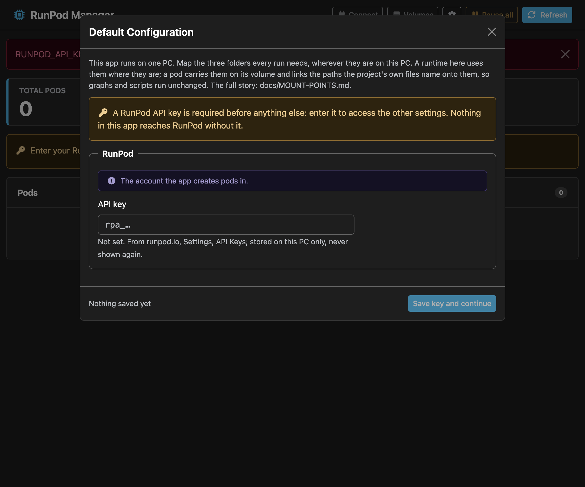

Paste the key. It is a password field: it is never shown in the clear.

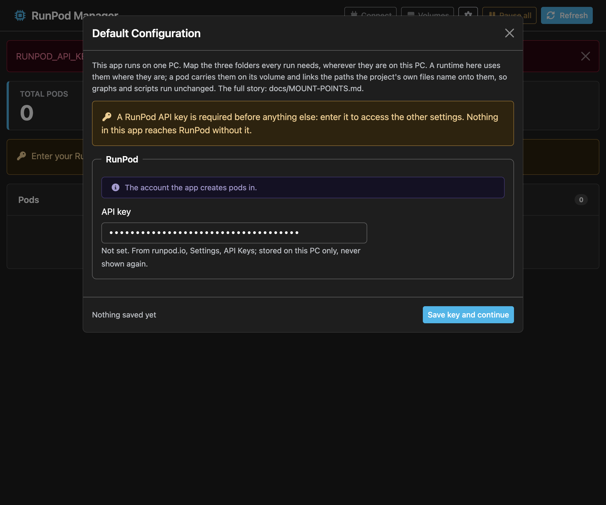

**Save key and continue.** The key is stored, only its last four characters are shown from now on, and the rest of the
panel fills in: the S3 keys and the Anthropic key (both optional; enter them now or later).

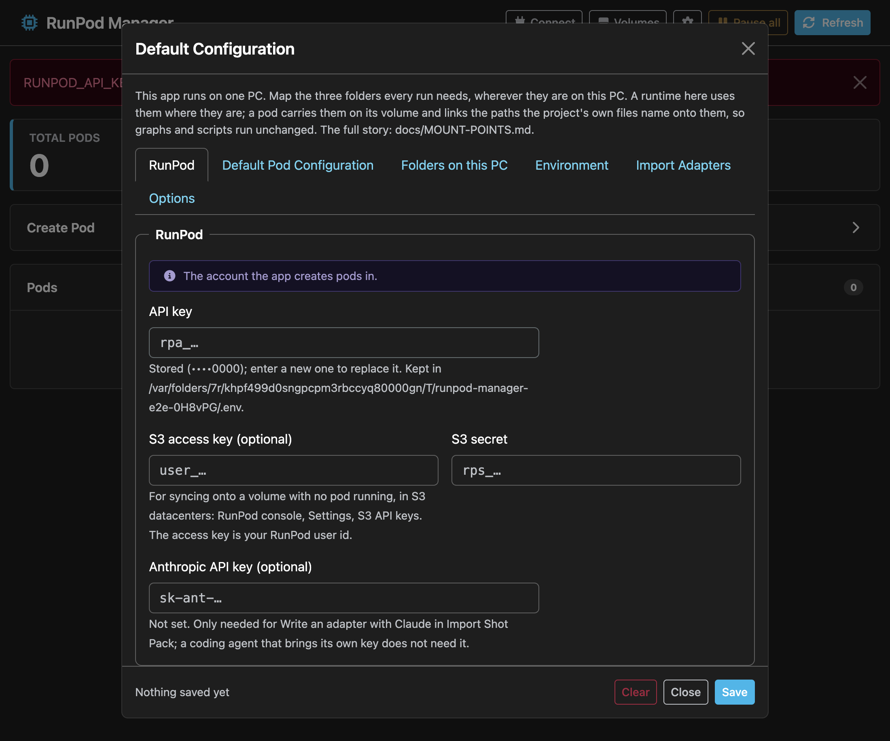

## 3. Default Configuration: where pods go and what they boot

**Default Pod Configuration** holds the datacenter, the network volume, the image and the idle stop. Set:

- **Image:** `ghcr.io/bluecollardev/comfy-app:contract-v26` (the downloaded app already has it).
- **Registry auth:** the ID of the container registry login from step 1.
- **Idle stop:** minutes of quiet before the pod stops itself (30 by default) so a forgotten pod does not keep billing.
- **Datacenter and Network volume:** after step 4 below.

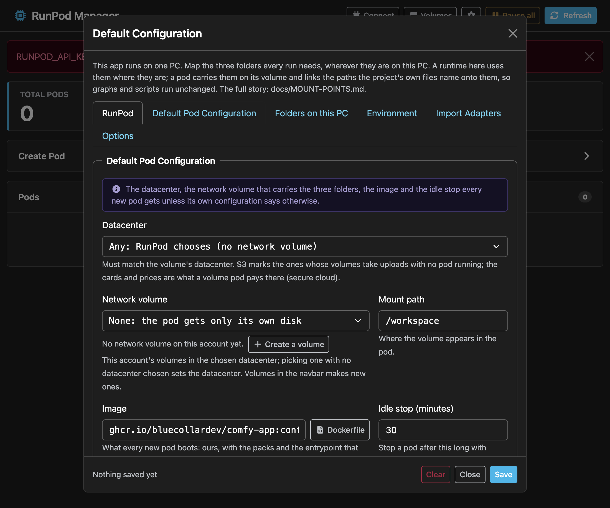

**Folders on this PC** says which folders on your machine are the project, the plates and ComfyUI-Shared, and which
ComfyUI-Shared folders **Push** and **Pull** carry (ADR-011).

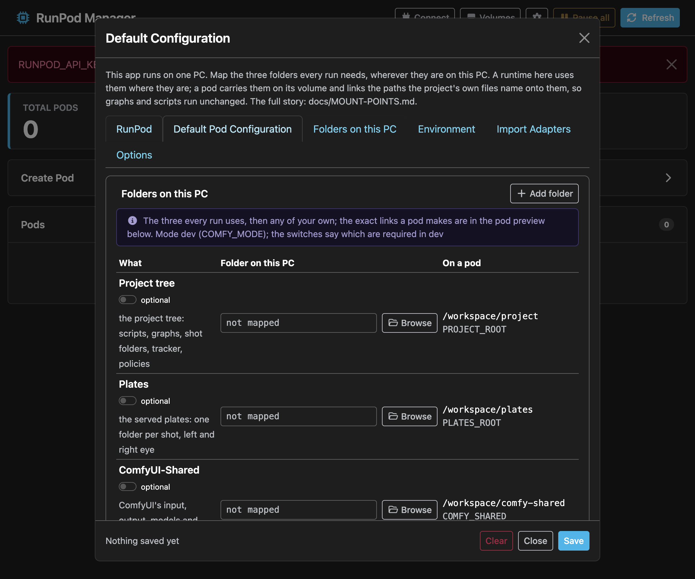

**Connect → Accounts** is for signing in to GitHub or GitLab; it tells you what to set (`GITHUB_CLIENT_ID`, `GITHUB_CLIENT_SECRET`) to enable a provider.

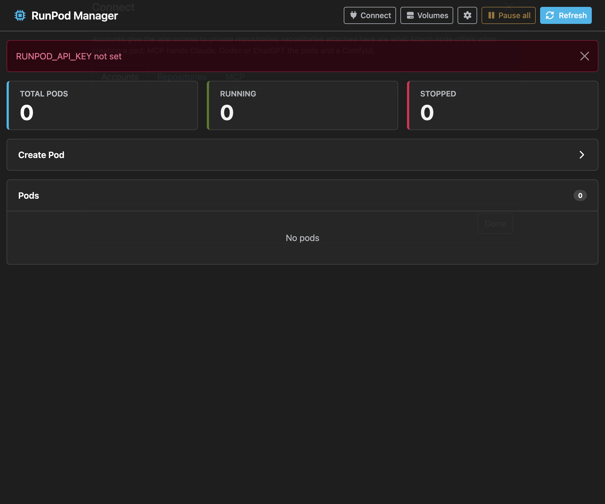

### Try it without a bill: no-spend mode
**Options → no-spend mode** simulates the RunPod account: pods, volumes and Sync run on screen and nothing is created
or billed. The badge in the header says so. Use it to learn the screens; turn it off when you are ready for real pods.
The rest of the screenshots use it.

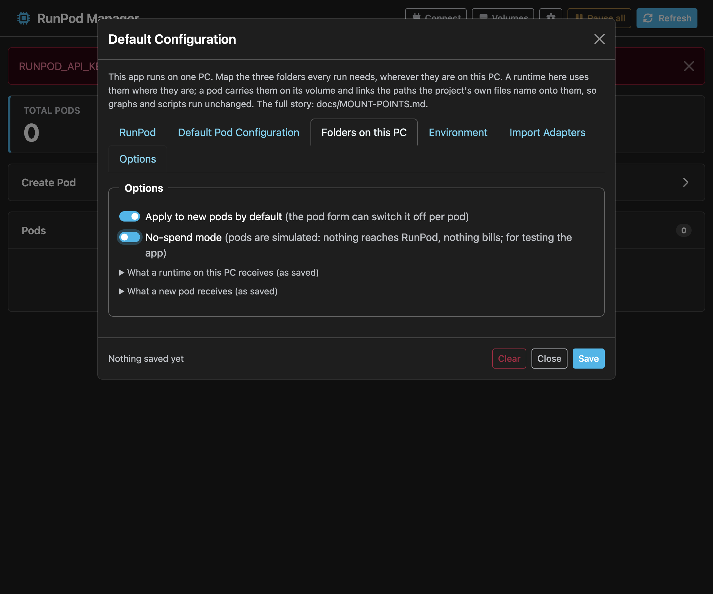

## 4. Create a network volume

A network volume is the disk that outlives pods: models, ComfyUI-Shared and the project live on it. Make one before the first pod.
**Volumes** in the header: a name, a size (100 GB is the usual start; about $7 a month) and a **datacenter**.

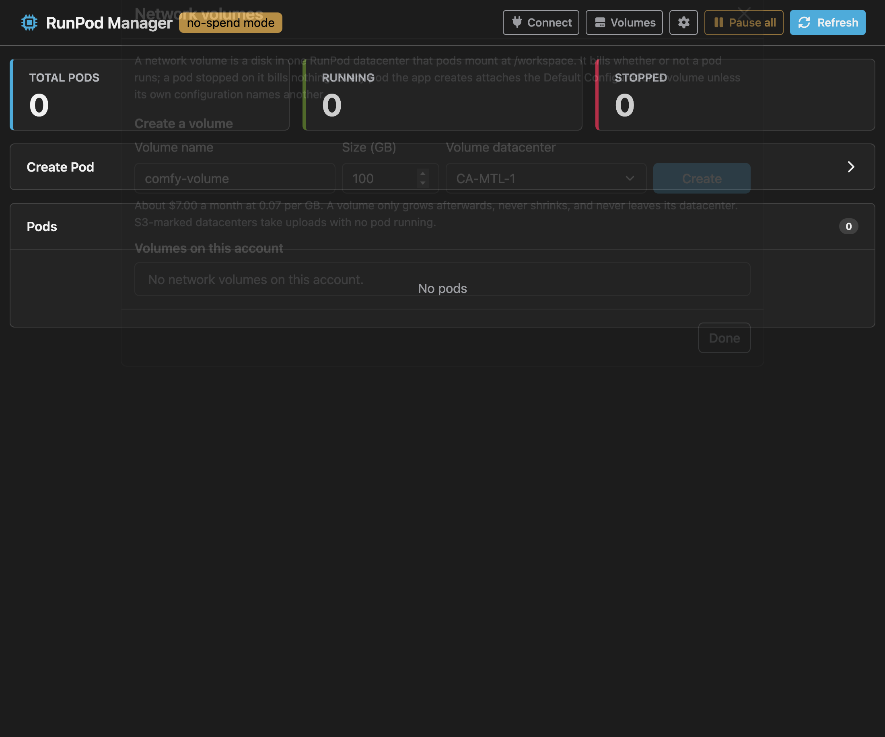

Pick a datacenter that has the GPUs you want and, if you will upload with no pod running, one marked **S3**. A pod must be in
the **same datacenter** as its volume.

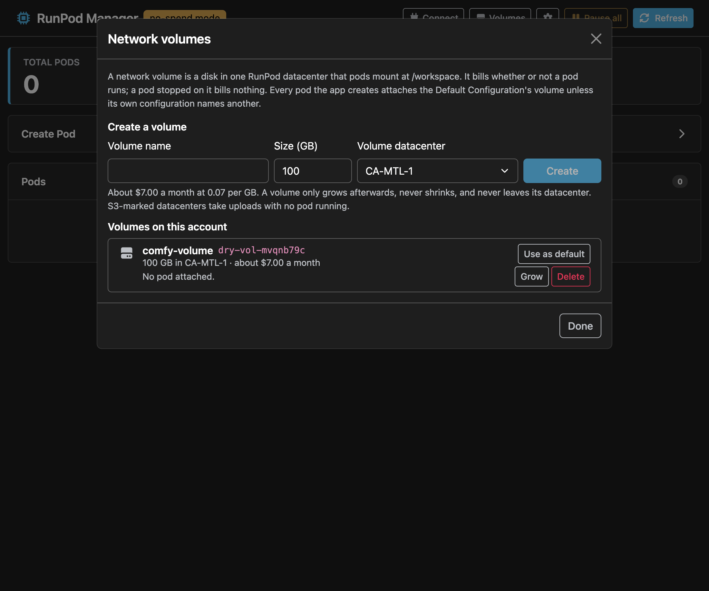

Back in Default Configuration → Default Pod Configuration, choose that volume (this also sets the datacenter) and save.
A volume ID copied from another account gives `Network volume "…" not found`: volumes belong to one account.

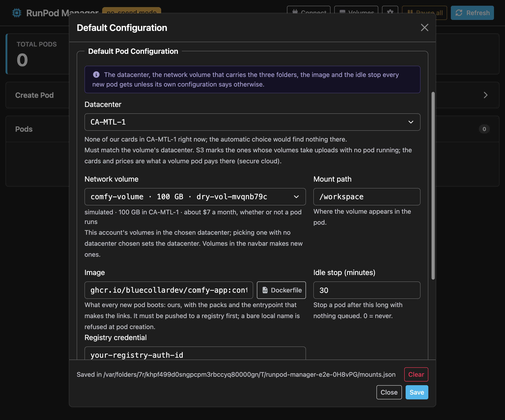

## 5. Create a pod

**Create Pod**: a name (`ComfyUI-Dev`), cloud, and GPU; the image and volume come from the defaults.

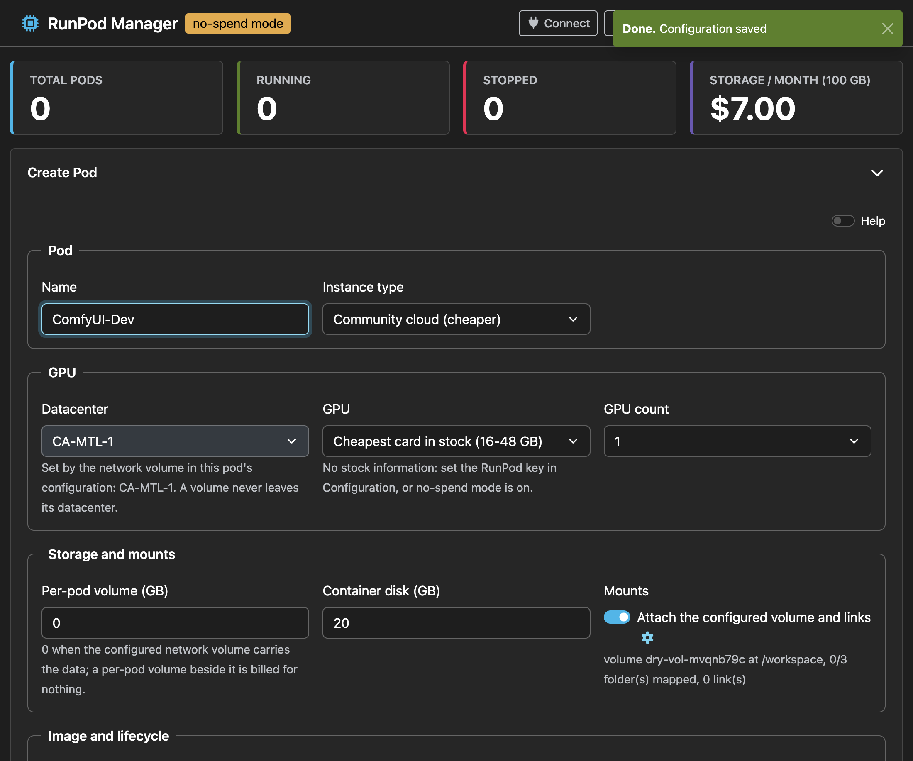

The pod appears with a step bar: requested, container up, then ComfyUI answering. The first start pulls the image
(about 5 GB) and takes several minutes; later starts are fast. Open **Logs** to watch it.

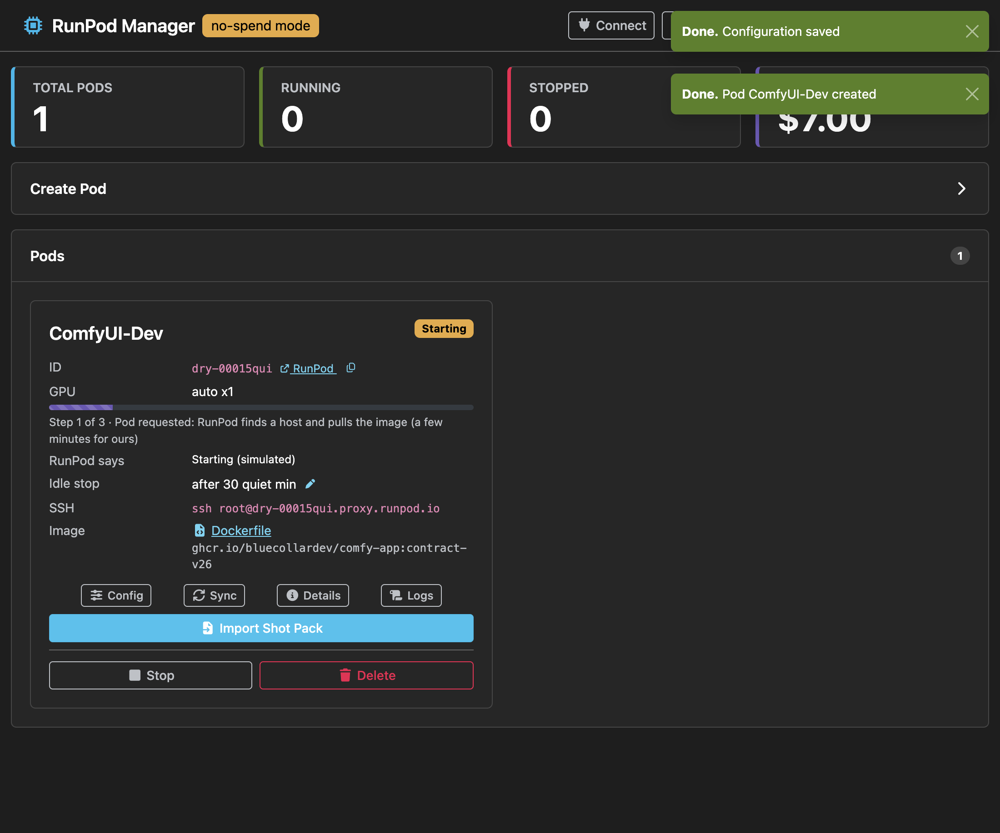

When it is running:
- **Open** is the ComfyUI link.
- The **Logs** should include `sshd on 22 (for ./start.sh sync)`. If not, see below.
- **Sync** copies your folders onto the volume (ADR-011); **Pull** brings renders back.
- **Stop** pauses billing; the volume stays.

## If something fails

| You see | Cause | Fix |
|---|---|---|
| Pod exits in seconds; Logs: `denied: access forbidden` / `unauthorized` | RunPod cannot pull the private image | Add the `ghcr.io` login on RunPod (step 1); put its ID in Registry auth; **create a new pod** (an existing pod keeps the old settings) |
| Sync: `ssh: connect … Connection refused` | No SSH public key on the RunPod account when the pod was created, or an old image without sshd | Add the key on RunPod, then **create a new pod**; check Logs for `sshd on 22` |
| `Network volume "…" not found` | The volume ID belongs to another account | Create or pick a volume on this account (step 4) |
| `RUNPOD_API_KEY not set` / `401` | No key, or the key was revoked | Default Configuration → RunPod API key |
| Pod has no free GPU on its host | RunPod's machine is full | **Recreate** on another host |
| Sync starts but copies nothing | Folders not mapped, or in Pull-only settings | Default Configuration → Folders on this PC |
| `fetch failed` everywhere | The PC cannot reach RunPod (offline, VPN or firewall) | Check the connection; **Refresh** |

More: [`SETUP.md`](./SETUP.md) (the pod by hand), [`ADR-006`](./ADR-006-image-registry-and-ci-build.md) (the image and its login), [`ADR-011`](./ADR-011-what-a-sync-carries.md) (what a sync carries), [`RELEASING.md`](./RELEASING.md).
